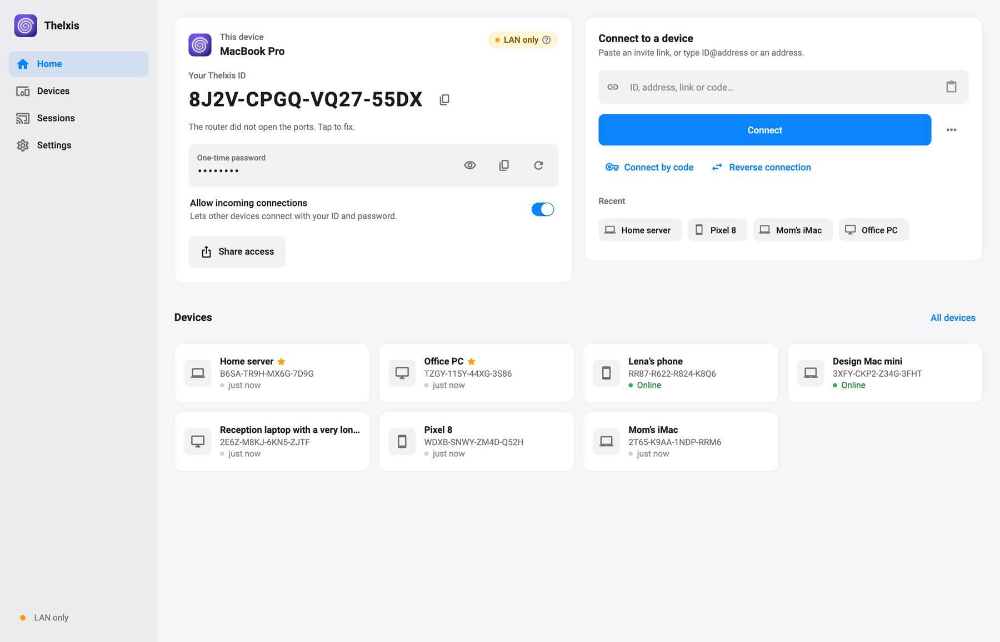
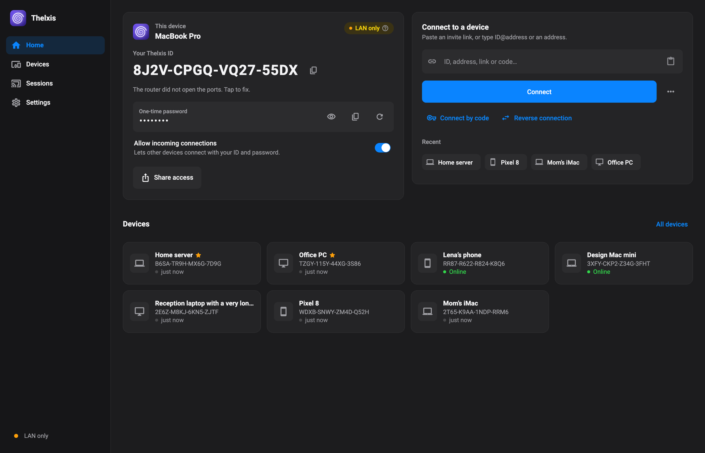
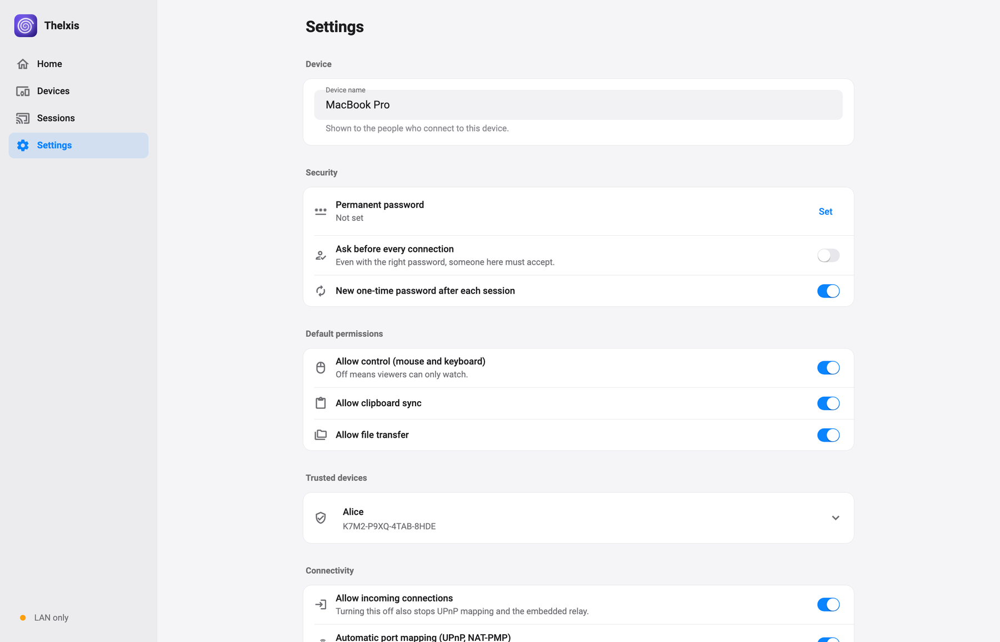
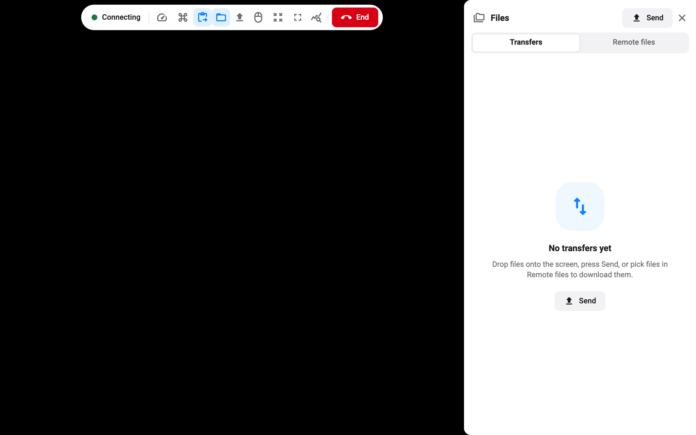
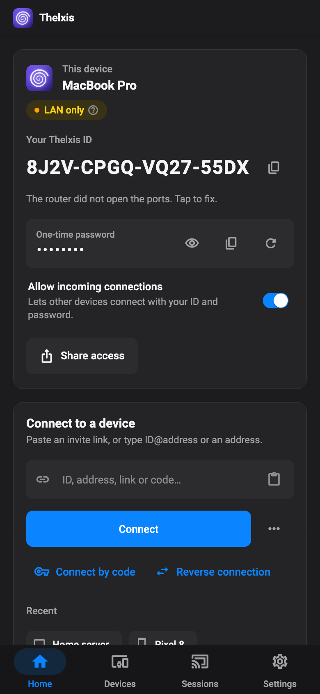

<div align="center">


# Thelxis

**Remote desktop with no servers. Direct, end-to-end encrypted, PC to PC.**
No accounts, no relays, no cloud. Encryption keys live only on your devices.

[](#download)
[](#download)
[](#download)
[](#download)
[](LICENSE)
[](https://boopi.ru)
[](https://boosty.to/boopi_coder)

**English** | [Русский](README.ru.md)



<a href="https://boosty.to/boopi_coder"></a>

</div>

---

## What it is

Thelxis is a cross-platform remote desktop for **Windows, macOS, Linux and Android**. One app is both the *host*
(the machine being controlled) and the *viewer* (the one controlling). Between the two devices there is nothing:
**no server, no account, no relay run by anyone.**

- **No intermediaries.** The connection goes PC to PC. Nothing in between can decrypt, record or see who talks to
  whom, apart from the network path itself.
- **End-to-end, keys only on devices.** Identity is an Ed25519 key that never leaves the machine. Media is
  protected by DTLS-SRTP bound to both identities.
- **Never freezes.** Screen transport is libwebrtc, the engine behind Chrome and Meet: congestion control,
  NACK/PLI/FEC, adaptive bitrate, hardware codecs, ICE restart on network change.
- **Works on a LAN or VPN with zero setup,** and over the internet as soon as one side is reachable. When nobody
  is, two short codes passed over any messenger are enough (see [How connecting works](#how-connecting-works)).

The name is Greek: Θέλξις (thelxis), "enchantment", the power of Hermes' wand over the eyes of men. The logo is
a spiral.

## Features

- **Screen and control**: mouse, keyboard, special keys, view-only mode, fit / 1:1 / fullscreen, live stats (RTT,
  fps, bitrate, loss, path type).
- **File transfer both ways**: drag and drop onto the session, a remote file browser (download and upload),
  a transfer queue with progress, speed and ETA, SHA-256 verification.
- **Clipboard** sync both ways (text).
- **Multiple monitors**: pick any display of the host and switch on the fly.
- **Quality presets** from "smooth" to "sharp".
- **Trusted devices** for unattended access, like SSH `authorized_keys`, with per-device permissions; address book
  with notes and tags, invite links and QR codes.
- **Mandatory on-screen badge** on the controlled PC: a small always-on-top window with who is connected and for
  how long. It cannot be hidden or disabled, and *Stop* ends the session at once.
- **Tray mode** on Windows, macOS and Linux: closing the window hides it to the tray, the listener keeps running;
  optional start at login, minimized.
- **Signed over-the-air updates** from GitHub Releases, verified against an Ed25519 key built into the app and
  installed only when no session is active. Can be turned off.
- **Russian and English** interface, **light and dark** theme.

## Screenshots

<table>
  <tr>
    <td align="center"><br><sub>Home, dark theme</sub></td>
    <td align="center"><br><sub>Settings</sub></td>
  </tr>
  <tr>
    <td align="center"><br><sub>Session with the remote file browser</sub></td>
    <td align="center"><br><sub>Android, dark theme</sub></td>
  </tr>
</table>

## How connecting works

There are no intermediary servers. The app tries these in order, and the first that works wins:

| # | Situation | How it connects |
|---|---|---|
| 1 | Same LAN or VPN (Tailscale, ZeroTier, WireGuard) | UDP discovery, direct addresses |
| 2 | Both sides have IPv6 | direct IPv6 |
| 3 | Host is reachable: public IP, automatic UPnP / NAT-PMP / PCP mapping, or a manual forward of 47100/tcp+udp and 47101/tcp | the viewer dials the host; the host's embedded STUN/TURN gets it through any NAT |
| 4 | Several office PCs behind one IP, one of them reachable | **office gateway**: the reachable PC pipes signaling and relays ciphertext to the others; encryption stays viewer to target |
| 5 | Only the viewer is reachable | **reverse connection**: the controlled side dials out to the viewer |
| 6 | Nobody is reachable (carrier-grade NAT on both sides) | **connect by code**: two short texts exchanged over any messenger, plus public STUN hole punching |
| 7 | Symmetric NATs on both sides, no IPv6 | impossible without a relay: use a VPN overlay |

Public STUN (Google, Cloudflare) is on by default; it reveals only an IP and port, never session data, and can be
turned off in settings.

Ports on the device itself: `47100/tcp` signaling (WebSocket), `47100/udp` embedded STUN/TURN, `47101/tcp` TURN
over TCP (for networks that block UDP), `47102/udp` LAN discovery.

## Download

Grab the build for your system from **[Releases](https://github.com/boopi-coder/thelxis/releases/latest)**:

| System | File |
|---|---|
| Windows 10 / 11 (x64) | `Thelxis-<ver>-windows-x64-setup.exe` (installer), `Thelxis-<ver>-windows-x64.zip` (portable) |
| macOS 12+ (Apple Silicon and Intel) | `Thelxis-<ver>-macos-universal.dmg` |
| Debian / Ubuntu and derivatives | `thelxis_<ver>_amd64.deb` |
| Linux x64 (any distribution) | `Thelxis-<ver>-linux-x64.tar.gz` |
| Android 7.0+ | `Thelxis-<ver>-android-<abi>.apk` (`arm64-v8a` for most phones; `universal` if unsure) |

SHA-256 checksums of every file are in `SHA256SUMS.txt` on the release page.

### First launch

The builds are not signed with a paid developer certificate, so the system warns you once.

**Windows.** SmartScreen shows *Windows protected your PC*: click *More info*, then *Run anyway*. The installer
adds Windows Firewall rules for `thelxis.exe` (inbound TCP 47100-47101, UDP 47100 and 47102) and removes them on
uninstall. With the portable `.zip`, allow the app through the firewall when Windows asks.

**macOS.** Drag Thelxis to Applications.
- macOS 12-14: right-click the app, *Open*, *Open*.
- macOS 15 and newer: try to open it, then go to *System Settings → Privacy & Security* and click *Open Anyway*.
- Or in Terminal: `xattr -dr com.apple.quarantine /Applications/Thelxis.app`

Then grant two permissions under *System Settings → Privacy & Security*: *Screen Recording* (to share your screen)
and *Accessibility* (to let a remote person use your mouse and keyboard), and restart the app. The app carries a
stable signature, so the permissions survive updates.

**Linux.** `.deb`: `sudo apt install ./thelxis_<ver>_amd64.deb`, then start Thelxis from the app menu or run
`thelxis`. `.tar.gz`: extract and run `./thelxis`; it needs GTK 3 and the X11 libraries (`libxtst6`, `libxrandr2`).
A sound server (PulseAudio or PipeWire) is required; any regular desktop has one, and the `.deb` pulls it in.
Remote control works in an **X11** session; on Wayland the screen can be shared but input is not supported yet.
For the tray icon, GNOME needs the AppIndicator extension (enabled by default on Ubuntu).

**Android.** Open the APK and allow installs from unknown sources for your browser or file manager. To let someone
control this phone, turn on the accessibility service: *Settings → Accessibility → Installed apps → Thelxis*. If
the switch is greyed out, open *Settings → Apps → Thelxis → ⋮ → Allow restricted settings* first. Screen sharing
asks for the system capture permission each time it starts.

## Security

- **Identity.** Each device has an Ed25519 key; the Thelxis ID is its fingerprint. The key never leaves the device.
- **Signed handshake.** The handshake and every SDP are signed, so the encrypted channel is bound to both
  identities and a man-in-the-middle cannot substitute it.
- **Transport.** DTLS-SRTP from libwebrtc. The embedded TURN only relays to its own machine (never an open relay)
  and carries already-encrypted packets.
- **Passwords never travel.** Authentication uses a session-bound proof; trusted devices use their signed key.
- **The host is always in charge.** The on-screen badge is mandatory and *Stop* ends the session instantly.
- **Signed updates.** Releases are installed only if the manifest carries a valid Ed25519 signature for the key
  built into the app.

Details: [docs/ARCHITECTURE.md](docs/ARCHITECTURE.md) and [docs/PROTOCOL.md](docs/PROTOCOL.md).

## Building from source

You need Flutter 3.47.7 plus the native toolchain of your target: Visual Studio (C++ desktop workload) on Windows,
Xcode on macOS, `clang cmake ninja-build pkg-config libgtk-3-dev liblzma-dev libx11-dev libxi-dev` on Linux
(Ubuntu 22.04+), JDK 17 and the Android SDK for Android.

```bash
git clone https://github.com/boopi-coder/thelxis.git
cd thelxis/app
flutter pub get
flutter run -d macos          # or windows / linux / <android device>
flutter build apk --release   # or: macos | windows | linux
```

Tests: `flutter analyze && flutter test`. Platform icons are redrawn by `packaging/icons/generate.sh`. Releases are
cut with a `v*` tag; see [packaging/README.md](packaging/README.md).

## Repository layout

```
app/          Flutter app (Windows, macOS, Linux, Android)
docs/         architecture, protocol, decisions, screenshots
packaging/    icons, Windows installer (Inno Setup), .deb builder, release notes template
.github/      GitHub Actions: CI and releases
```

## Support the project

Thelxis is free and open source. If it saves you time, support development on **[Boosty](https://boosty.to/boopi_coder)** — it funds current projects and helps launch new ones.

<a href="https://boosty.to/boopi_coder"></a>

## License

MIT, see [LICENSE](LICENSE). Use it, change it, ship it.

<div align="center">

Made by [boopi.ru](https://boopi.ru) · [Русская версия README](README.ru.md)

</div>
