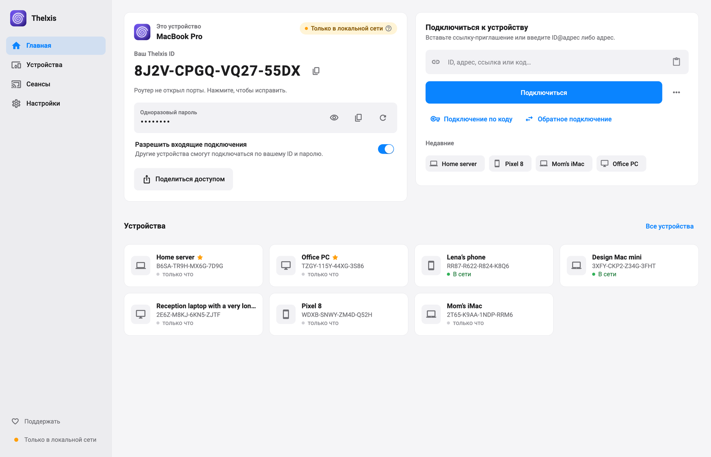
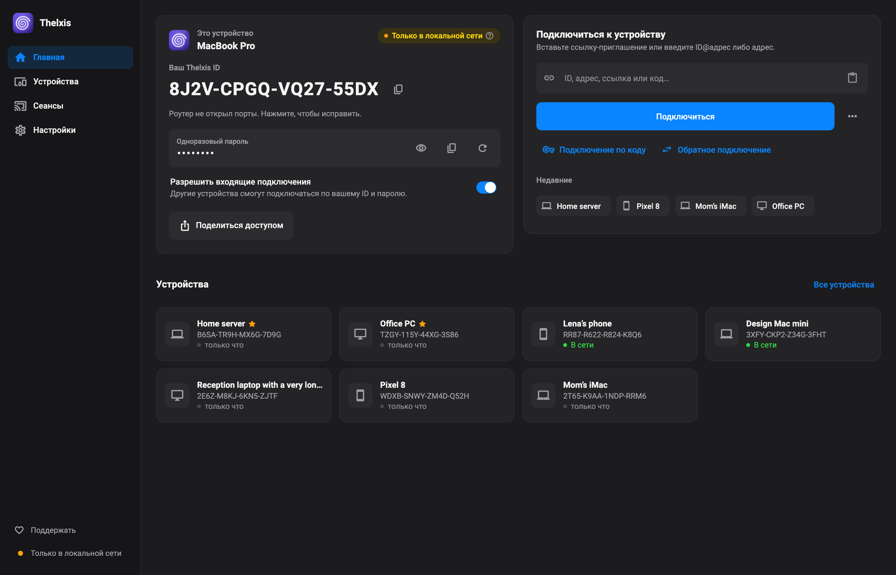
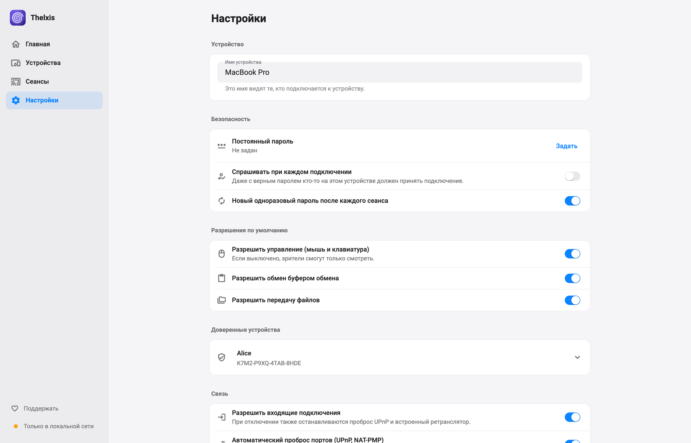
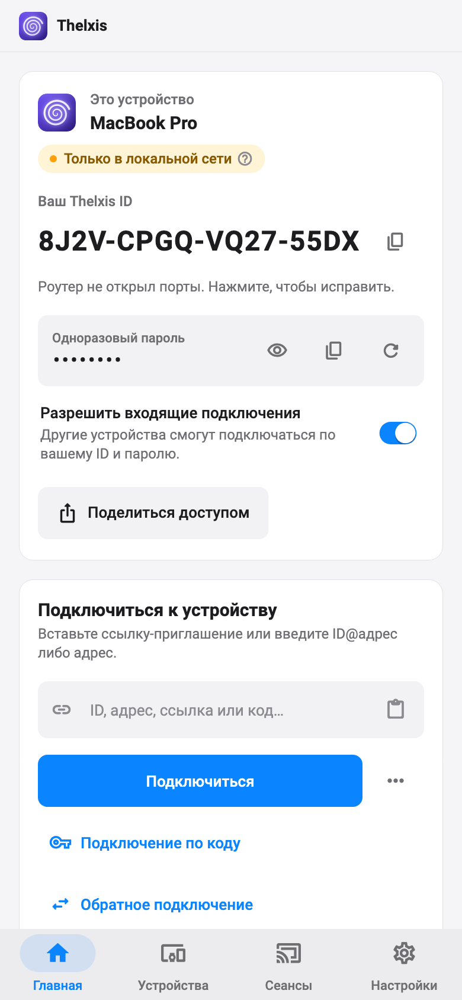

<div align="center">


# Thelxis

**Удалённый рабочий стол без серверов. Прямое сквозное шифрование, компьютер - компьютер.**
Без аккаунтов, без реле, без облака. Ключи шифрования есть только на ваших устройствах.

[](#скачать)
[](#скачать)
[](#скачать)
[](#скачать)
[](LICENSE)
[](https://boopi.site)
[](https://boosty.to/boopi_coder)

[English](README.md) | **Русский**



<a href="https://boosty.to/boopi_coder"></a>

</div>

---

## Почему Thelxis

Thelxis - кроссплатформенный удалённый рабочий стол для **Windows, macOS, Linux и Android**. Одно приложение
работает и как *хост* (им управляют), и как *зритель* (вы управляете). Между двумя устройствами нет ничего:
**ни сервера, ни аккаунта, ни чьего-то реле.**

- **Без посредников.** Соединение идёт напрямую, компьютер - компьютер. Ничто посередине не может расшифровать
  трафик, записать его или увидеть, кто с кем общается, кроме самого сетевого пути.
- **Сквозное шифрование, ключи только на устройствах.** Идентичность - ключ Ed25519, он не покидает машину.
  Видео защищено DTLS-SRTP, привязанным к обеим идентичностям.
- **Не зависает.** Экран передаёт libwebrtc, движок Chrome и Meet: контроль перегрузки, NACK/PLI/FEC, адаптивный
  битрейт, аппаратные кодеки, перезапуск ICE при смене сети.
- **В локальной сети и VPN работает без настройки,** а через интернет - как только доступна хотя бы одна сторона.
  Если недоступны обе, хватит двух коротких кодов, переданных через любой мессенджер (см.
  [Как устанавливается соединение](#как-устанавливается-соединение)).

Имя греческое: Θέλξις (thelxis) - «очарование, завораживание», сила жезла Гермеса над взглядом людей. Логотип -
спираль.

## Возможности

- **Экран и управление**: мышь, клавиатура, специальные клавиши, режим «только просмотр», по размеру окна / 1:1 /
  полный экран, живая статистика (RTT, fps, битрейт, потери, тип пути).
- **Передача файлов в обе стороны**: перетаскивание на сессию, удалённый файловый браузер (скачать и загрузить),
  очередь передач с прогрессом, скоростью и оставшимся временем, проверка SHA-256.
- **Буфер обмена** в обе стороны (текст).
- **Несколько мониторов**: любой дисплей хоста, переключение на лету.
- **Пресеты качества** от «плавно» до «чётко».
- **Доверенные устройства** для доступа без присутствия, как `authorized_keys` в SSH, с правами по устройствам;
  адресная книга с заметками и тегами, ссылки-приглашения и QR.
- **Обязательная плашка на экране** управляемого компьютера: небольшое окно поверх всех, где видно, кто
  подключён и как давно. Скрыть или отключить её нельзя, а кнопка «Стоп» сразу завершает сессию.
- **Режим трея** на Windows, macOS и Linux: закрытие окна прячет его в трей, приём подключений продолжается;
  по желанию запуск при входе в систему, свёрнутым.
- **Подписанные обновления по воздуху** из GitHub Releases: проверяются ключом Ed25519, зашитым в приложение, и
  ставятся только когда нет активной сессии. Отключаются в настройках.
- Интерфейс на **русском и английском**, **светлая и тёмная** темы.

## Скриншоты

<table>
  <tr>
    <td align="center"><br><sub>Главный экран, тёмная тема</sub></td>
    <td align="center"><br><sub>Настройки</sub></td>
  </tr>
  <tr>
    <td align="center"><br><sub>Сессия с удалённым файловым браузером</sub></td>
    <td align="center"><br><sub>Android</sub></td>
  </tr>
</table>

## Как устанавливается соединение

Серверов-посредников нет. Приложение пробует варианты по порядку, срабатывает первый удачный:

| # | Ситуация | Как подключаемся |
|---|---|---|
| 1 | Одна локальная сеть или VPN (Tailscale, ZeroTier, WireGuard) | UDP-обнаружение, прямые адреса |
| 2 | У обоих есть IPv6 | прямой IPv6 |
| 3 | Хост доступен: публичный IP, авто-проброс UPnP / NAT-PMP / PCP или ручной проброс 47100/tcp+udp и 47101/tcp | зритель подключается к хосту; встроенный STUN/TURN хоста проводит через любой NAT |
| 4 | Несколько офисных ПК за одним IP, один из них доступен | **офисный шлюз**: доступный ПК пробрасывает сигнализацию и передаёт шифротекст остальным; шифрование остаётся между зрителем и целью |
| 5 | Доступен только зритель | **обратное соединение**: управляемая сторона сама подключается к зрителю |
| 6 | Недоступны оба (CGNAT с обеих сторон) | **подключение по коду**: два коротких текста, которыми стороны обмениваются через любой мессенджер, плюс пробивка NAT через публичный STUN |
| 7 | Симметричные NAT с обеих сторон, нет IPv6 | без реле невозможно: используйте VPN-оверлей |

Публичный STUN (Google, Cloudflare) включён по умолчанию; он раскрывает только IP и порт, но не данные сессии, и
отключается в настройках.

Порты на самом устройстве: `47100/tcp` сигнализация (WebSocket), `47100/udp` встроенный STUN/TURN, `47101/tcp`
TURN поверх TCP (для сетей, блокирующих UDP), `47102/udp` обнаружение в локальной сети.

## Скачать

Сборки для вашей системы - на странице **[Releases](https://github.com/boopi-coder/thelxis/releases/latest)**:

| Система | Файл |
|---|---|
| Windows 10 / 11 (x64) | `Thelxis-<версия>-windows-x64-setup.exe` (установщик), `Thelxis-<версия>-windows-x64.zip` (без установки) |
| macOS 12+ (Apple Silicon и Intel) | `Thelxis-<версия>-macos-universal.dmg` |
| Debian / Ubuntu и производные | `thelxis_<версия>_amd64.deb` |
| Linux x64 (любой дистрибутив) | `Thelxis-<версия>-linux-x64.tar.gz` |
| Android 7.0+ | `Thelxis-<версия>-android-<abi>.apk` (`arm64-v8a` для большинства телефонов; `universal`, если не уверены) |

Контрольные суммы SHA-256 всех файлов - в `SHA256SUMS.txt` на странице релиза.

### Первый запуск

Сборки не подписаны платным сертификатом разработчика, поэтому система один раз предупредит.

**Windows.** SmartScreen покажет «Windows защитила ваш компьютер»: нажмите *Подробнее*, затем *Выполнить в любом
случае*. Установщик добавляет правила брандмауэра для `thelxis.exe` (входящие: TCP 47100-47101, UDP 47100 и 47102)
и убирает их при удалении. С портативным `.zip` разрешите доступ в брандмауэре, когда Windows спросит.

**macOS.** Перетащите Thelxis в «Программы».
- macOS 12-14: правый клик по приложению, *Открыть*, *Открыть*.
- macOS 15 и новее: попробуйте открыть, затем *Системные настройки → Конфиденциальность и безопасность* и
  кнопка *Всё равно открыть*.
- Или в Терминале: `xattr -dr com.apple.quarantine /Applications/Thelxis.app`

Затем выдайте два разрешения в *Системные настройки → Конфиденциальность и безопасность*: *Запись экрана* (чтобы
показывать свой экран) и *Универсальный доступ* (чтобы удалённый человек мог пользоваться мышью и клавиатурой), и
перезапустите приложение. Приложение подписано постоянным сертификатом, поэтому разрешения сохраняются при
обновлениях.

**Linux.** `.deb`: `sudo apt install ./thelxis_<версия>_amd64.deb`, затем запустите Thelxis из меню приложений или
командой `thelxis`. `.tar.gz`: распакуйте и запустите `./thelxis`; нужны GTK 3 и библиотеки X11 (`libxtst6`,
`libxrandr2`). Нужен звуковой сервер (PulseAudio или PipeWire); он есть на любом обычном рабочем столе, а `.deb`
подтянет его сам. Управление работает в сеансе **X11**; в Wayland экран показать можно, но ввод пока не
поддерживается. Для значка в трее в GNOME нужно расширение AppIndicator (в Ubuntu включено по умолчанию).

**Android.** Откройте APK и разрешите установку из неизвестных источников для браузера или файлового менеджера.
Чтобы кто-то мог управлять этим телефоном, включите службу специальных возможностей: *Настройки → Специальные
возможности → Установленные приложения → Thelxis*. Если переключатель серый, сначала откройте *Настройки →
Приложения → Thelxis → ⋮ → Разрешить ограниченные настройки*. Показ экрана каждый раз запрашивает системное
разрешение на захват.

## Безопасность

- **Идентичность.** У каждого устройства ключ Ed25519; Thelxis ID - его отпечаток. Ключ не покидает устройство.
- **Подписанное рукопожатие.** Рукопожатие и каждый SDP подписаны, поэтому зашифрованный канал привязан к обеим
  идентичностям, и подменить его (MITM) нельзя.
- **Транспорт.** DTLS-SRTP из libwebrtc. Встроенный TURN передаёт данные только на собственную машину (открытым
  реле не бывает) и несёт уже зашифрованные пакеты.
- **Пароль по сети не передаётся.** Аутентификация использует доказательство, привязанное к сессии; доверенные
  устройства входят по подписанному ключу.
- **Хост всегда главный.** Плашка на экране обязательна, а «Стоп» мгновенно завершает сессию.
- **Подписанные обновления.** Релиз ставится, только если манифест несёт верную подпись Ed25519 для ключа,
  зашитого в приложение.

Подробнее: [docs/ARCHITECTURE.md](docs/ARCHITECTURE.md) и [docs/PROTOCOL.md](docs/PROTOCOL.md).

## Сборка из исходников

Нужен Flutter 3.47.7 и тулчейн целевой платформы: Visual Studio (C++ desktop) на Windows, Xcode на macOS,
`clang cmake ninja-build pkg-config libgtk-3-dev liblzma-dev libx11-dev libxi-dev` на Linux (Ubuntu 22.04+),
JDK 17 и Android SDK для Android.

```bash
git clone https://github.com/boopi-coder/thelxis.git
cd thelxis/app
flutter pub get
flutter run -d macos          # или windows / linux / <android-устройство>
flutter build apk --release   # или: macos | windows | linux
```

Тесты: `flutter analyze && flutter test`. Иконки платформ перерисовывает `packaging/icons/generate.sh`. Релиз
выпускается тегом `v*`; см. [packaging/README.md](packaging/README.md).

## Структура репозитория

```
app/          Flutter-приложение (Windows, macOS, Linux, Android)
docs/         архитектура, протокол, решения, скриншоты
packaging/    иконки, установщик Windows (Inno Setup), сборка .deb, шаблон описания релиза
.github/      GitHub Actions: CI и выпуск релизов
```

## Поддержать проект

Thelxis бесплатный и с открытым кодом. Если он экономит вам время — поддержите разработку на **[Boosty](https://boosty.to/boopi_coder)**: это помогает развивать текущие проекты и запускать новые.

<a href="https://boosty.to/boopi_coder"></a>

## Лицензия

MIT, см. [LICENSE](LICENSE). Используйте, меняйте, распространяйте.

<div align="center">

Сделано в [boopi.site](https://boopi.site) · [English README](README.md)

</div>
